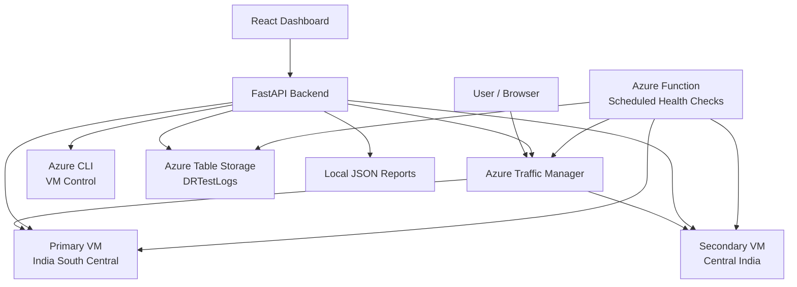

# SentinelDR

## Multi-Region Disaster Recovery Cloud Setup with Automated Disaster Recovery Validation Engine

SentinelDR is a cloud disaster recovery project built on Microsoft Azure to demonstrate multi-region application availability, automated health monitoring, traffic failover, recovery time measurement, and primary-region restoration.

The project combines a React dashboard, a FastAPI backend, Azure Traffic Manager, Azure Virtual Machines, Azure Functions, and Azure Table Storage to monitor infrastructure and record disaster recovery test results.

## Features

- **Multi-region infrastructure:** Primary and secondary application servers deployed in separate Azure regions.
- **Traffic management:** Azure Traffic Manager routes incoming traffic between regional endpoints.
- **Live monitoring:** Periodic HTTP health checks monitor the primary server, secondary server, and Traffic Manager endpoint.
- **Automated failover testing:** Execute a controlled test that deallocates the primary VM and monitors recovery through the secondary region.
- **Recovery time measurement:** Measure the observed Recovery Time Objective (RTO) during a failover test.
- **Primary restoration:** Attempt to restart the primary VM after the test and verify that it becomes available again.
- **Persistent logging:** Store scheduled health checks and failover results in Azure Table Storage.
- **Interactive dashboard:** Visualize endpoint health, response latency, historical reliability, failover results, and recovery analytics.
- **Recovery reports:** Save test results locally in JSON format and maintain a JSON Lines history file.

## Architecture



## Technology Stack

| Component | Technology |
|---|---|
| Cloud Platform | Microsoft Azure |
| Regional Infrastructure | Azure Virtual Machines |
| Traffic Routing | Azure Traffic Manager |
| Scheduled Monitoring | Azure Functions |
| Persistent Logging | Azure Table Storage |
| Backend | Python, FastAPI |
| Frontend | React, Vite, JavaScript |
| Infrastructure as Code | Terraform |
| Version Control | Git, GitHub |

## Deployment Configuration

| Resource | Configuration |
|---|---|
| Primary Region | India South Central |
| Secondary Region | Central India |
| Traffic Routing | Azure Traffic Manager |
| Scheduled Monitoring Interval | 5 minutes |
| Dashboard Refresh Interval | 10 seconds |
| Storage Table | `DRTestLogs` |

Resource names and endpoints are configured for the project environment. Credentials and other sensitive configuration values must remain private.

## Demonstrated Failover Results

An end-to-end failover test was successfully executed against the deployed Azure infrastructure.

| Metric | Observed Result |
|---|---|
| Secondary Recovery | Confirmed |
| Measured RTO | 139.54 seconds |
| Primary Restoration | Confirmed |
| Azure Report Upload | Successful |

### Failover Test Workflow

1. Check the primary and secondary application endpoints.
2. Verify that Traffic Manager is initially serving the primary region.
3. Request deallocation of the primary Azure VM.
4. Poll Traffic Manager until the secondary region is observed serving traffic.
5. Calculate the measured RTO.
6. Attempt to restart the primary VM and verify its recovery.
7. Save the test report locally and upload the result to Azure Table Storage.

The reported RTO represents the result of one specific test. Actual recovery time may vary depending on endpoint monitoring, routing behavior, network propagation, and infrastructure conditions.

**Warning:** Running a failover test affects real Azure infrastructure and may temporarily interrupt traffic. Verify the environment and recovery procedures before executing a test.

## Project Structure

```text
multi-region-disaster-recovery/
├── dashboard_api.py
├── frontend/
│   ├── public/
│   ├── src/
│   │   ├── App.jsx
│   │   ├── App.css
│   │   ├── LatencyChart.jsx
│   │   ├── ReliabilityChart.jsx
│   │   └── RecoveryAnalytics.jsx
│   ├── package.json
│   └── vite.config.js
├── reports/
│   ├── latest-report.json
│   ├── dr-history.jsonl
│   └── failover-*.json
└── README.md
```

## Getting Started

### Prerequisites

- Python
- Node.js and npm
- Azure CLI
- An Azure subscription with the required permissions
- Terraform, if managing infrastructure through Terraform
- Azure resources configured for the project

### 1. Clone the Repository

```bash
git clone https://github.com/FlameAmaan/multi-region-disaster-recovery.git
cd multi-region-disaster-recovery
```

### 2. Configure the Backend

Create a Python virtual environment and install the required backend dependencies.

For Windows PowerShell:

```powershell
python -m venv .venv
.\.venv\Scripts\python.exe -m pip install fastapi uvicorn azure-data-tables
```

Install any additional dependencies required by the backend code.

Authenticate with Azure:

```powershell
az login
```

Configure the `AZURE_STORAGE_CONNECTION_STRING` environment variable in your local terminal. Keep the connection string private and never commit it to version control.

Start the backend:

```powershell
.\.venv\Scripts\python.exe -m uvicorn dashboard_api:app --reload --port 8000
```

The FastAPI documentation is available at:

`http://127.0.0.1:8000/docs`

### 3. Start the Frontend

Open a second terminal:

```powershell
cd frontend
npm install
npm run dev
```

Open the dashboard at:

`http://localhost:5173/`

### 4. Execute a Failover Test

1. Open the **Failover Tests** tab.
2. Verify that both regional endpoints and Traffic Manager are healthy.
3. Confirm that Azure authentication and the storage connection are configured.
4. Select **Run failover test** and review the confirmation warning.
5. Monitor the measured RTO, recovery status, primary restoration status, and report upload status.

The backend must expose the `/api/failover/run` route. The Azure identity used to execute the test must have sufficient permissions to manage the primary VM.

## Dashboard Sections

### Overview

Displays current endpoint health, Azure monitoring freshness, latency, reliability, and recovery analytics.

### Infrastructure

Displays regional endpoint status and response information.

### Failover Tests

Allows users to execute controlled failover tests and review recorded recovery results.

### Event Logs

Displays scheduled monitoring records retrieved from Azure Table Storage.

## Security and Operational Considerations

- Never commit `.env` files, credentials, private keys, or Azure storage connection strings.
- Use least-privilege Azure permissions for VM management and storage access.
- Keep Azure authentication and sensitive configuration local to the development environment.
- Verify secondary-region availability before deallocating the primary VM.
- Check the primary VM state if a failover test fails or times out.
- Monitor Azure resource usage and costs.
- Validate the environment before running any test that affects live infrastructure.

## Project Objective

The objective of SentinelDR is to demonstrate how cloud applications can maintain availability across regions and how disaster recovery can be validated through measurable, repeatable tests rather than relying solely on infrastructure configuration.

## Author

**FlameAmaan**

GitHub: [@FlameAmaan](https://github.com/FlameAmaan)

## License

No license has been specified for this repository.

---

*SentinelDR: Monitor. Recover. Validate.*